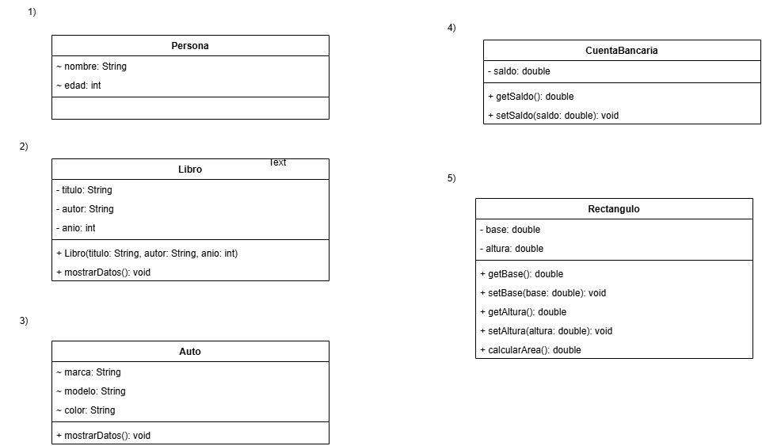
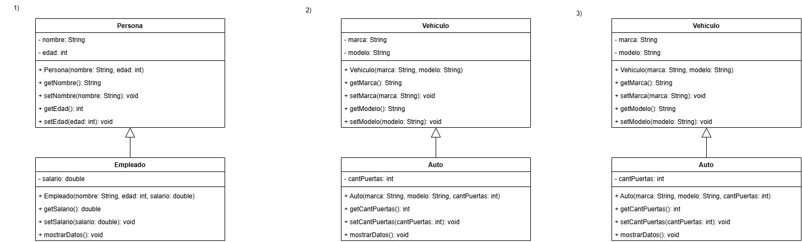

# Trabajo de Repaso de POO

Cada ejercicio es un proyecto Java independiente. Dentro de `src`, el archivo `Main.java` ejecuta el ejercicio y las clases del modelo están en sus propios archivos.

| Práctico | Punto | Proyecto |
| --- | --- | --- |
| Clases y objetos | 1 | [Persona](01-Persona/) |
| Clases y objetos | 2 | [Libro](02-Libro/) |
| Clases y objetos | 3 | [Auto](03-Auto/) |
| Clases y objetos | 4 | [CuentaBancaria](04-CuentaBancaria/) |
| Clases y objetos | 5 | [Rectangulo](05-Rectangulo/) |
| Herencia simple | 1 | [Persona y Empleado](06-Persona-Empleado/) |
| Herencia simple | 2 | [Vehiculo y Auto](07-Vehiculo-Auto/) |
| Herencia simple | 3 | [Animal y Perro](08-Animal-Perro/) |

## Ejecutar un proyecto

Entrá a la carpeta del ejercicio y, con un JDK instalado, ejecutá:

```sh
javac -encoding UTF-8 -d out src/*.java
java -cp out Main
```

## Diagramas UML

### Clases y objetos



### Herencia



En el punto 5 de Clases y Objetos se instancia `Rectangulo`, la clase que pide definir el enunciado. Su área se calcula como base por altura.
